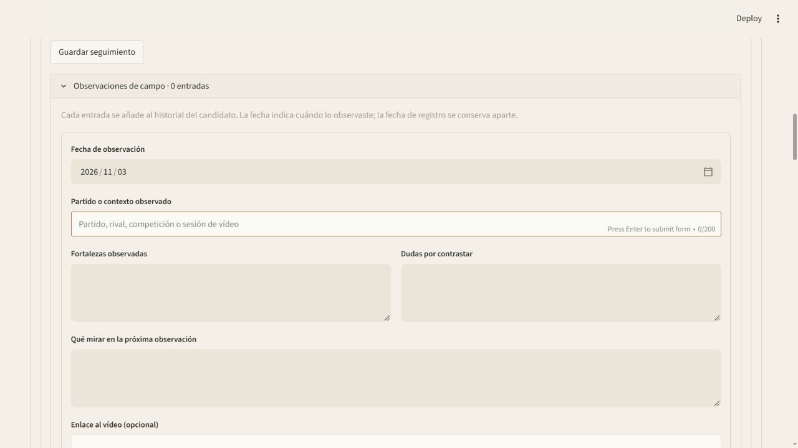
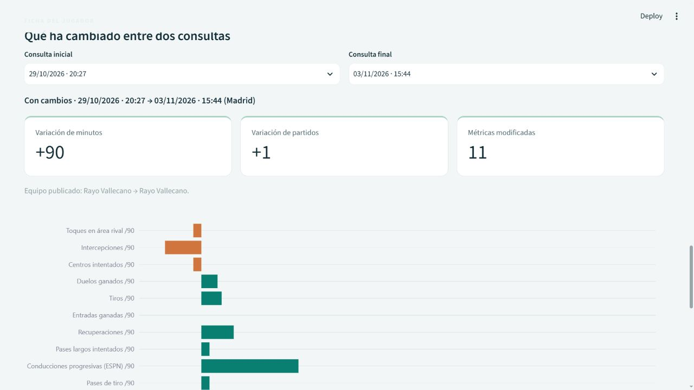
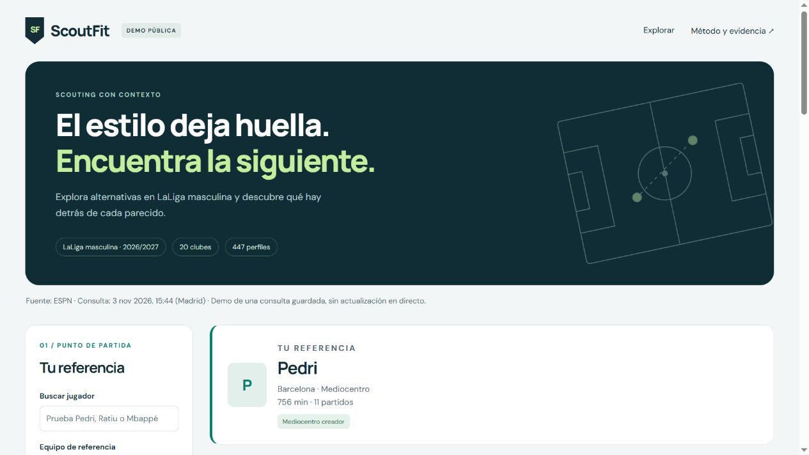
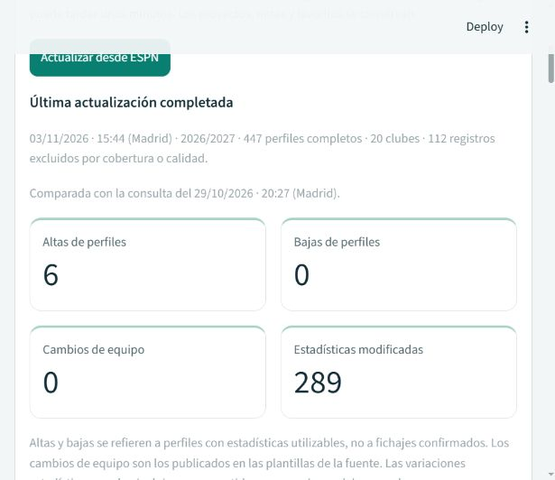
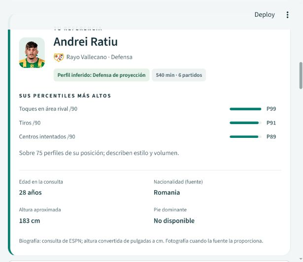
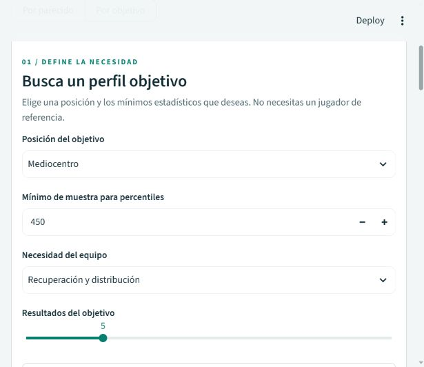
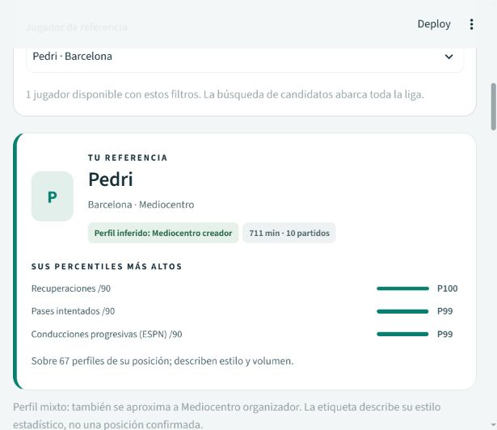

# Historial de ScoutFit

Este registro conserva las funciones y comprobaciones de cada versión. Las cifras
corresponden a su fecha de validación; no describen una consulta en tiempo real.

## Preparación del repositorio · 03/11/2026

- README centrado en presentación, instalación y alcance; historial y metodología
  separados para facilitar la revisión del proyecto.
- Guías de arquitectura, contribución y preparación del portafolio.
- Comando común de verificación local y CI, con temporales independientes.
- Matriz de CI configurada para Windows/Linux y Python 3.11/3.12.
- Comprobación de las distribuciones e instalación aislada del wheel para verificar
  importación, CLI y plantilla del informe, sin utilizar el paquete editable.
- Lista explícita de contenido del archivo fuente y exclusiones de datos locales.

## Novedades de la versión 0.12



- **Historial de observaciones por candidato:** entradas independientes con fecha de
  observación, partido o contexto, fortalezas, dudas, próxima observación y enlace
  al vídeo con posición opcional. Se añade cada entrada sin sobrescribir las anteriores.
  Un error de validación conserva el texto del formulario para poder corregirlo.
- **Ficha individual con criterio propio:** conclusión humana justificada (seguir
  mirando, encaja parcialmente o descartar), firma opcional, datos de temporada,
  percentiles, historial y nota general. HTML autónomo para imprimir/guardar como PDF
  desde el navegador, y JSON con los valores completos y las fechas de referencia.
- **Compatibilidad con tu cuaderno:** los proyectos anteriores funcionan sin migración;
  la nota general y el estado de seguimiento se conservan. Las conclusiones no se
  generan a partir de las distancias ni se convierten en etiquetas de evaluación.

Abre **Archivo de trabajo → Proyectos de scouting y búsquedas guardadas**, selecciona
proyecto y candidato y despliega **Observaciones de campo** o **Informe individual ·
conclusión y firma**. Guarda la conclusión antes de descargar para incluirla en la ficha.
Estas funciones y sus contenidos son locales a la aplicación completa.

Validación: **199 pruebas superadas**, plantilla incluida en el paquete instalable y
descarga HTML comprobada en navegador. [Guía del cuaderno individual](docs/OBSERVACIONES_E_INFORMES.md).

## Funciones de la versión 0.11

La dirección visual elegida es un **cuaderno de scouting: sobrio, editorial y con
detalles de campo**. La aplicación y la demo comparten fondo de papel, tinta oscura,
acento rojizo, títulos con serif y pequeñas anotaciones en monoespaciada. Los nombres
y los datos tienen prioridad sobre la decoración.

- Las herramientas de proyectos, actualización y evaluación están agrupadas en
  **Archivo de trabajo · proyectos, datos y revisión**, encima del buscador.
- Las recomendaciones se presentan como lista de observación, con menos recuadros,
  etiquetas y mensajes promocionales. Los informes HTML comparten la misma identidad.
- La demo pública usa fuentes del sistema, sin descargar tipografías externas.
  Su segunda publicación conserva la consulta y los cálculos del ranking.

Validación: 34 pruebas de interfaz, dos pruebas de informes y 1.119 búsquedas de
paridad Python/JavaScript. [Criterio de diseño y mantenimiento](docs/IDENTIDAD_VISUAL.md).

## Funciones de la versión 0.10



- **Seguimiento de proyectos:** compara cada candidato con la consulta en la que
  se guardó; muestra variación de minutos y partidos, equipos publicados y número
  de métricas modificadas. Las notas y estados no se alteran. Se distingue una base
  ausente, otra temporada y una consulta activa anterior a la de origen.
- **Contexto de muestra:** población completa por posición, clubes, mediana de minutos
  y avisos de participación reducida. Un análisis opcional compara mínimos 450/600/900
  manteniendo prioridades, objetivos y filtros; muestra coincidencia del top mediante
  Jaccard y se invalida cuando cambia la búsqueda. Disponible en ambos modos.
- **Ficha visual entre consultas:** elige jugador y fechas en Evolución, consulta las
  variaciones de minutos/partidos y las doce métricas con valores anteriores y actuales.
  Las tasas /90 se muestran en un gráfico y los porcentajes en puntos porcentuales.
  Exportación CSV/JSON y aviso de posibles correcciones del proveedor.

En un proyecto, selecciona un candidato y abre **Qué ha cambiado en mis candidatos**;
activa **Mostrar seguimiento del proyecto**. La ficha usa por defecto su consulta de
origen. Para comparar otro jugador, abre **Evolución → Jugador de evolución** y baja
hasta **Qué ha cambiado entre dos consultas**. En Recomendaciones o Resultados del
objetivo, abre **Contexto de muestra · minutos y población** y pulsa **Comparar mínimos
de minutos**. Estas funciones se ejecutan en la aplicación completa de Streamlit.

La participación acumulada no es un intervalo de confianza. Una subida estadística
no implica mejora deportiva. Consulta [el alcance y los ejemplos](docs/SEGUIMIENTO_Y_MUESTRA.md).

## Funciones de la versión 0.9



- **Evaluación guiada:** campaña congelada de 20 referencias y 302 parejas para la
  consulta del 03/11/2026. Compara las métricas de cada pareja sin mostrar el ranking,
  recoge relevancia 0/1/2, revisor y justificación, y continúa por las pendientes.
- **Informe de evidencia:** progreso, cobertura y comparación de métodos solo sobre
  las parejas revisadas. Los estados `pending_review`, `partial_review` y `evaluated`
  distinguen la falta de revisión de una campaña completa. No se inventan etiquetas.
- **Demo pública en Sites:** búsqueda por nombre/equipo, muestra de minutos,
  prioridades, filtro de candidatos, comparativa de valores y percentiles,
  explicación de distancia y descarga CSV. Usa una consulta guardada de 447 perfiles;
  no actualiza ESPN ni expone proyectos, notas o valoraciones locales.
- **Paridad comprobada:** 1.119 búsquedas de la demo coinciden con el ranking de
  Python en orden y distancias; también se verifican contribuciones, percentiles
  con empates y conservación de escala al filtrar clubes.

En la aplicación completa, abre **Evaluación guiada · 20 referencias** y pulsa
**Preparar o continuar evaluación**. Las valoraciones reales siguen pendientes:
la infraestructura de evaluación no sustituye el criterio de una persona.
Consulta [el protocolo](docs/EVALUACION.md) y [la publicación de la demo](docs/DEMO_PUBLICA.md).

## Funciones de la versión 0.8



- **Actualización desde la interfaz:** consulta actual de LaLiga masculina, progreso
  por fases y recarga automática. También sirve para preparar una instalación sin datos.
- **Activación protegida:** descarga y construcción en un directorio temporal, checksum
  de fuentes y validación de liga, temporada, género, clubes, métricas e identidades.
  Se exige al menos un 85 % de perfiles utilizables sobre los jugadores consultados;
  una caída superior al 20 % frente a la misma temporada también se rechaza.
  La consulta anterior permanece activa si falla la descarga, construcción o validación.
- **Resumen persistente:** altas y bajas de perfiles utilizables, cambios de equipo
  publicados en las plantillas y variaciones de estadísticas, con valores anteriores
  y actuales en un JSON descargable. Las bajas de cobertura no se llaman traspasos.
  Un cambio de fuente, liga, temporada o definición de métricas se presenta sin
  inferir cambios deportivos entre poblaciones distintas.
- **Bloqueo entre procesos:** solo una actualización por instalación, tanto desde
  Streamlit como desde `scoutfit update`. El bloqueo del sistema se libera al terminar
  o al salir el proceso. Un cambio externo de la consulta activa durante la descarga
  impide sobrescribirlo.
- **Conservación del trabajo:** no se modifican proyectos, favoritos, revisiones ni
  notas. Se sigue la referencia por ID de jugador si la fuente cambia su equipo.

Cada consulta validada incluye `update_report.json` en su carpeta procesada. El último
intento queda en `data/updates/last_attempt.json`; las carpetas temporales se limpian
al terminar y estas rutas no se incluyen en Git. Se conserva el histórico anterior.
El botón consulta cuando lo pulsas: no crea una tarea programada ni promete datos en directo.

La comprobación real del 03/11/2026 consultó 486 jugadores y activó 447 perfiles:
6 incorporados, ninguna baja ni cambio de equipo y 289 con estadísticas modificadas
frente a la consulta anterior. La selección de referencia se conservó al recargar.
Validación de software: **160 pruebas superadas** y comprobaciones de Ruff.

## Funciones de la versión 0.7



- **Fichas con contexto:** edad en la fecha de consulta, nacionalidad publicada,
  altura aproximada en centímetros, escudo y fotografía cuando ESPN la proporciona.
  La consulta actual contiene edad/nacionalidad para 434 de los 441 perfiles, altura
  para 428, escudos para todos y fotografía para 13. El pie dominante no está publicado
  en estas plantillas: se muestra «No disponible». No se adivinan fotografías ni datos.
- **Proyectos de scouting:** crea una carpeta con nombre y descripción, guarda búsquedas
  de ambos modos y organiza candidatos como pendientes, interesantes o descartados,
  con notas propias. Los favoritos siguen siendo una lista independiente.
- **Recuperar búsquedas:** restaura jugador u objetivo, métricas, pesos, cumplimiento
  estricto, número de resultados, filtros de clubes e intervalo de minutos.
  Si cambia la consulta se avisa; si cambia la temporada/fuente o falta un club/referencia
  necesario, se rechaza la recuperación sin aplicar una configuración parcial.
- **Seguimiento persistente:** los candidatos se identifican por fuente, liga, temporada
  e ID de jugador, conservando sus notas y estado tras un cambio de equipo. Se muestra
  el equipo al guardar y el de la consulta actual. Exportación a JSON y CSV.

Para empezar, abre **Proyectos de scouting y búsquedas guardadas** encima del selector
de modo y crea un proyecto. Configura una búsqueda y usa **Guardar esta búsqueda en…**.
En la ficha de un candidato pulsa **Añadir a…**. Vuelve al gestor para cambiar su estado,
escribir notas o recuperar una búsqueda. Reutilizar un nombre de búsqueda la actualiza.

Las biografías se leen de las plantillas originales del mismo snapshot, verificadas
con SHA-256 y equipo/temporada; no se hacen consultas nuevas ni se alteran los perfiles
estadísticos. La altura se convierte de pulgadas a centímetros y la edad se calcula
a la fecha de consulta cuando hay nacimiento. Fotos y escudos cargan desde las URLs
de ESPN presentes en los datos; las iniciales cubren perfiles sin fotografía.
Los proyectos están en `data/user/projects.json`, excluido de Git, y sobreviven al
reinicio de la aplicación. Son locales a esta instalación; no son cuentas de usuario.

## Funciones de la versión 0.6



- **Por objetivo:** elige posición y una necesidad, como «Recuperación y distribución».
  Ajusta las métricas, percentiles mínimos e importancia de 1 a 5. No se crea un
  jugador ficticio ni se usa una referencia oculta.
- **Brecha explicable:** raíz media cuadrática ponderada de los puntos de percentil
  pendientes. Superar un mínimo no penaliza ni compensa los déficits de otras métricas.
  Brecha cero equivale a cumplir los objetivos estadísticos, no a calidad o éxito de fichaje.
  Los empates se ordenan por más minutos y después por nombre/identificador.
- **Exigencia opcional:** «Exigir que se cumplan todos los objetivos» devuelve solo
  quienes cumplen todos los mínimos. Si nadie cumple, no se relajan los requisitos.
- **Filtros independientes de candidatos:** clubes incluidos, clubes excluidos e
  intervalo inclusivo de minutos. La exclusión prevalece sobre la inclusión y una
  lista vacía de incluidos significa todos. Se mantienen al alternar los dos modos.
- **Comparación y seguimiento:** compara dos o tres resultados reales, descarga su
  informe con el objetivo y filtros, guárdalos en favoritos o usa uno como referencia
  de una nueva búsqueda por parecido. Configuración JSON y resultados CSV exportables.

Los filtros de candidatos se aplican **antes del top-k y después de calcular**
distancias/percentiles; no cambian las puntuaciones del resto de jugadores. El
mínimo de muestra define la población de cálculo y se aplica además del intervalo
de candidatos. Por ejemplo, una referencia con 900 minutos puede mantenerse al
buscar candidatos con 450–800 minutos, si el mínimo de muestra es 450.
El mapa muestra la población completa como contexto, resaltando solo el top-k filtrado.
Las comparativas conservan percentiles de la posición completa. En Evaluación,
sensibilidad y métodos respetan los filtros; la revisión manual conserva su benchmark
equilibrado sin filtros personales.

## Funciones de la versión 0.5

- **Nueva identidad visual:** cabecera táctica, fichas de referencia con iniciales,
  tarjetas de alternativas, indicadores y navegación con desplazamiento en pantallas pequeñas.
- **ADN estadístico:** radar de las doce métricas por percentiles de la posición.
  Se puede alternar con las diferencias estandarizadas y comparar hasta tres jugadores.
  Los radios y el área del radar no equivalen a una puntuación de calidad.
- **Mapa de perfiles:** proyección PCA de la posición completa, con la referencia,
  sus candidatos y el resto del grupo. Informa qué proporción de variación conserva
  en dos dimensiones. Se puede explorar otro jugador y usarlo como referencia.
- **Pesos personalizados:** importancia de 0× a 5× para cada métrica, con opción
  de restablecer la prioridad y exportar la configuración a JSON. Cambian el ranking
  y la proyección; los percentiles mantienen su población de referencia.
- **Comparación directa:** botón en cada una de las tres primeras alternativas
  para abrir la comparativa con ese candidato. El informe HTML comparte el nuevo estilo.



El mapa usa las mismas métricas estandarizadas y pesos de la búsqueda, escalados
por `sqrt(peso / suma de pesos)`, y ajusta PCA sobre todo el grupo elegible de
posición, liga, temporada y fuente. Incluye otros equipos y estilos como contexto.
Las distancias visuales son aproximadas: el ranking usa el espacio completo.
No se proyectan grupos sin variación ni de menos de tres jugadores.

## Funciones de la versión 0.4

La app organiza el trabajo en recomendaciones, comparativa, favoritos, evaluación,
evolución y el nuevo mapa. Los controles de referencia siguen visibles
en la pantalla principal.

- **Comparativa:** referencia más uno o dos jugadores de la misma posición,
  valores /90 y percentiles calculados sobre todos los jugadores elegibles.
  Permite añadir notas y descargar un informe HTML autónomo, preparado para imprimir.
- **Favoritos:** lista local persistente con notas, equipo al guardar y equipo
  de la consulta activa. No se pierde un seguimiento cuando el jugador cambia
  de club dentro de la temporada. Se puede exportar a CSV.
- **Evaluación:** comparación euclídea/coseno, 30 perturbaciones reproducibles
  de pesos y sensibilidad al mínimo de minutos. Las frecuencias y Jaccard
  describen estabilidad, no probabilidad de acierto.
- **Revisión manual:** rúbrica de relevancia 0/1/2, justificación, plantilla de
  20 referencias y carga de CSV revisados. No se asignan etiquetas inventadas.
  nDCG, precisión y recuperación se calculan únicamente dentro del conjunto
  revisado y se informa la cobertura del top-k completo.
- **Evolución:** consultas reales guardadas, cambios de equipo y agregados de
  temporada. Las tasas entre consultas se calculan solo cuando hay minutos
  nuevos y conteos consistentes. No equivalen a estadísticas por partido.

Los favoritos y valoraciones se guardan en `data/user/`, los borradores de
benchmark en `data/evaluation/` y los informes de CLI en `reports/`. Estas rutas
se excluyen de Git. Son archivos locales compartidos por esta instalación,
no cuentas de usuario ni almacenamiento en la nube.

```powershell
uv run scoutfit benchmark --queries 20
uv run scoutfit import-reviews RUTA_AL_CSV_REVISADO.csv
uv run scoutfit evaluate
```

`evaluate` deja el estado `pending_review` cuando faltan valoraciones suficientes.
La app permite importar la plantilla desde la pestaña Evaluación sin usar la CLI.
Consulta [la guía de evaluación](docs/EVALUACION.md) y el
[registro de validación](docs/VALIDACION.md).

## Novedades de la versión 0.3

Los filtros están en la pantalla principal, también en móvil. Busca por nombre
sin preocuparte por las tildes (`Mbappe`, `alex baena`), filtra por equipo y posición
y cambia la referencia desde la lista. La selección se conserva al cambiar pesos,
número de candidatos o recargar datos; solo cambia si deja de ser válida con
los filtros. Si una búsqueda no encuentra jugadores, se explica y puedes borrarla.

ScoutFit añade nueve **perfiles estadísticos inferidos**. Cuando hay una etiqueta,
la comparación usa por defecto el mismo perfil y puedes ampliar a toda la posición
con la casilla «Comparar solo el mismo perfil inferido». Los resultados y el CSV
incluyen el perfil y si es mixto o predominante. No se amplía automáticamente el
grupo si no hay candidatos: se muestra un mensaje para que decidas cómo buscar.

Las etiquetas se obtienen con reglas de afinidad a arquetipos y percentiles,
no con clustering ni con posiciones tácticas observadas. Se usan al menos ocho
jugadores con 450 minutos dentro de cada posición, liga y temporada; esa base
permanece fija aunque cambies filtros o prioridades. Los perfiles de poca muestra
siguen disponibles, pero se comparan por su posición publicada.

Consulta las [reglas, pesos y límites](docs/PERFILES_INFERIDOS.md). Para aplicar
el filtro de estilo también en la CLI:

```powershell
uv run scoutfit recommend "espn:250465:83" --same-profile --top-k 5
```
