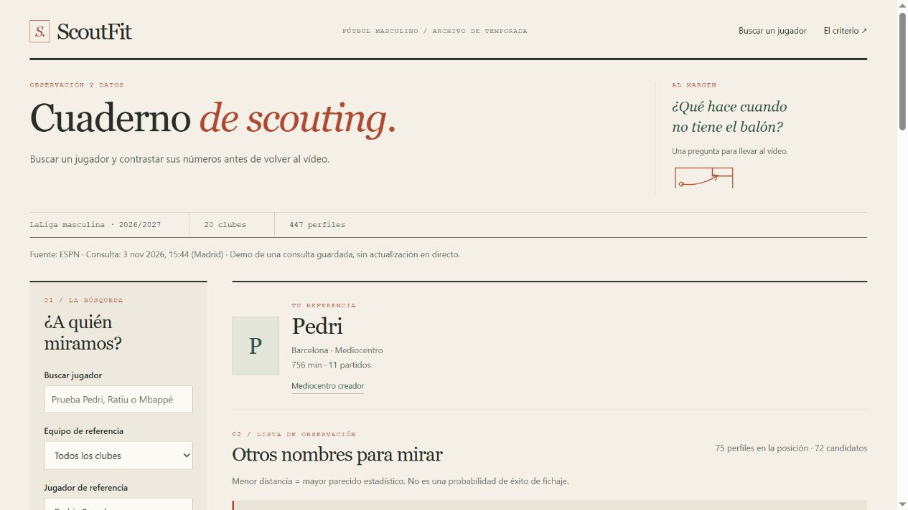

# ScoutFit · Cuaderno de scouting

Buscar un jugador parecido es un punto de partida. ScoutFit ayuda a explicar
ese parecido, revisar sus límites y construir un criterio propio con observaciones.

[**Probar la demo pública →**](https://scoutfit-laliga-demo.berry-clock-7103.chatgpt.site)
· [Arquitectura](docs/ARQUITECTURA.md)
· [Datos y metodología](docs/METODOLOGIA.md)
· [Historial de versiones](CHANGELOG.md)



Proyecto personal de análisis de **LaLiga masculina** con Python, Streamlit,
Pandas, NumPy, Scikit-learn y Plotly. Combina un pipeline de datos verificable,
similitud explicable y un cuaderno local de seguimiento.

## Qué puedes hacer

- Buscar por parecido a cualquier referencia o definir un objetivo sin jugador inicial.
- Entender el ranking mediante distancias, contribuciones por métrica y percentiles.
- Comparar jugadores, consultar contexto de muestra y seguir cambios entre consultas.
- Guardar proyectos, candidatos y observaciones; redactar una conclusión propia y
  descargar fichas individuales en HTML imprimible o JSON.
- Revisar la estabilidad técnica e importar valoraciones humanas del recomendador.

La aplicación completa guarda el cuaderno en tu disco. La **demo pública es una
versión de consulta**, con datos fechados y búsquedas interactivas; no incluye
los proyectos privados ni descarga datos nuevos.

## Datos y alcance

La consulta documentada del **3 de noviembre de 2026**, temporada **2026/27**,
contiene **447 perfiles utilizables de los 20 clubes**. Es una fotografía de esa
fecha: la actualización se solicita desde la app o la terminal, sin tarea automática.

Las plantillas y estadísticas proceden de servicios JSON públicos de ESPN.
El club es el de la plantilla consultada; las estadísticas abarcan al jugador en
liga y temporada y pueden incluir minutos de un club anterior. No se rellenan
métricas ausentes con ceros. Los porteros se excluyen de este modelo.

El ranking utiliza distancia estandarizada y ponderada. Los perfiles de estilo
se obtienen con reglas explícitas. **No es una predicción de éxito de fichaje ni
un modelo supervisado entrenado con fichajes reales.** La evaluación externa
de relevancia futbolística está pendiente de revisiones humanas suficientes.

## Ejecutar en tu equipo

Requisitos: Python **3.11 o 3.12** y [uv](https://docs.astral.sh/uv/getting-started/installation/).
Desde la carpeta del repositorio, los mismos comandos funcionan en Windows,
Linux y macOS; la CI configura Windows y Linux con ambas versiones de Python.

```sh
uv sync --locked --extra dev --python 3.12
uv run streamlit run app.py
```

Abre [localhost:8501](http://localhost:8501). Si aún no hay datos, abre
**Archivo de trabajo → Actualizar datos y ver cambios** y solicita la primera
consulta. También puedes descargar y activar el conjunto desde la terminal:

```sh
uv run scoutfit update
```

La primera consulta requiere conexión y puede tardar varios minutos. No necesita
clave API; estos endpoints no tienen un contrato de disponibilidad para ScoutFit.
Después de actualizar desde la terminal, pulsa **Recargar datos locales** en la app.
Las búsquedas funcionan con los archivos descargados.

Para consultar los comandos disponibles:

```sh
uv run scoutfit --help
```

El experimento histórico de StatsBomb es opcional y usa sus propias métricas,
sin mezclar fuentes. [Instrucciones del conjunto histórico](docs/HISTORICO_STATSBOMB.md).

## Comprobar el proyecto

```sh
uv run --locked --extra dev python scripts/check.py
```

Comprueba el lockfile sin conexión, Ruff y las pruebas locales. Las pruebas usan
fixtures sintéticos y carpetas temporales, sin consultar ESPN ni modificar tu cuaderno.

Para comprobar también la distribución instalable:

```sh
uv run --locked --extra dev python scripts/check.py --package
```

Construye el wheel y el archivo fuente, revisa su contenido e instala el wheel
en un entorno temporal independiente con las dependencias de `uv.lock`.
Verifica la importación, el comando `scoutfit` y la generación de HTML desde la
plantilla instalada. Esta fase puede necesitar red si no hay dependencias en caché.
La CI configura esta misma comprobación en Windows/Linux y Python 3.11/3.12.

## Cómo está organizado

```text
app.py                  Interfaz Streamlit
src/scoutfit/           Pipeline, búsqueda, evaluación y cuaderno
src/scoutfit/templates/ Plantilla del informe individual
tests/                  Pruebas unitarias, integración y AppTest
scripts/                Comprobaciones locales y del paquete instalado
demo/                   Fuente de la demo estática y comprobación de paridad
docs/                   Decisiones, metodología y evidencias de validación
```

La [guía de arquitectura](docs/ARQUITECTURA.md) explica las responsabilidades,
el flujo de datos y la separación entre estadísticas y criterio humano.

## Guías

| Necesidad | Documento |
| --- | --- |
| Entender métricas, pesos y límites | [Metodología](docs/METODOLOGIA.md) |
| Conocer las reglas de estilo | [Perfiles inferidos](docs/PERFILES_INFERIDOS.md) |
| Revisar estabilidad y relevancia humana | [Evaluación](docs/EVALUACION.md) |
| Seguir evolución y tamaño de muestra | [Seguimiento](docs/SEGUIMIENTO_Y_MUESTRA.md) |
| Anotar y exportar una ficha | [Cuaderno individual](docs/OBSERVACIONES_E_INFORMES.md) |
| Consultar comprobaciones reales | [Validación](docs/VALIDACION.md) |
| Contribuir o preparar una entrega | [CONTRIBUTING](CONTRIBUTING.md) |
| Defender el proyecto en una entrevista | [Guía de portafolio](docs/PORTAFOLIO.md) |
| Practicar con el proyecto | [Primera semana](docs/PRIMERA_SEMANA.md) |
| Conocer la demo y su alcance | [Demo pública](docs/DEMO_PUBLICA.md) |

## Fuentes y licencia

Código bajo [MIT](LICENSE). Datos, fotografías, logotipos y marcas conservan
las condiciones de sus proveedores. ScoutFit es independiente de ESPN y StatsBomb.
Los datos originales, las tablas locales, las notas personales y los informes
generados se excluyen de Git y de las distribuciones del proyecto.

Consulta [NOTICE.md](NOTICE.md) para las fuentes y atribuciones. La demo muestra
una selección de estadísticas numéricas con fecha y fuente; no publica respuestas
JSON originales, fotografías ni logotipos de ESPN.
