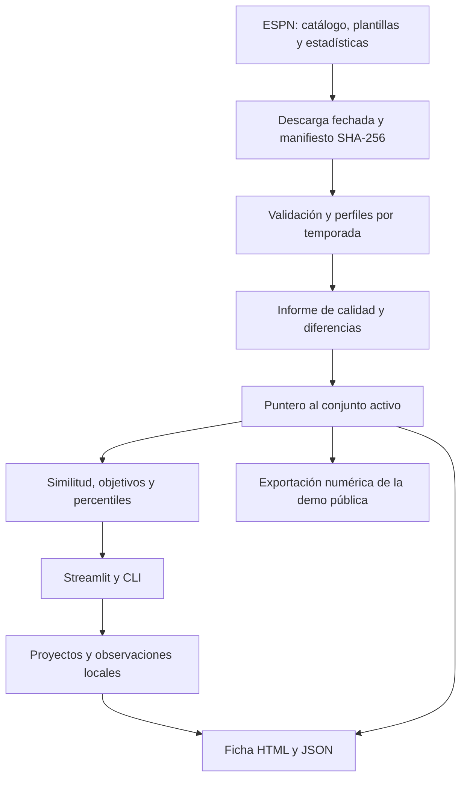

# Arquitectura de ScoutFit

ScoutFit es una aplicación local de análisis. Streamlit coordina las vistas;
el paquete `scoutfit` contiene las transformaciones y reglas que también utiliza
la CLI. Los proyectos se guardan en archivos locales, sin servicio de cuentas.

## Recorrido de los datos

La actualización prepara un conjunto nuevo y valida integridad y cobertura antes
de cambiar `data/processed/active.json`. El bloqueo de actualización evita que dos
procesos activen conjuntos a la vez. Un fallo conserva el conjunto anterior y los
archivos personales; el historial permite comparar consultas.

## Responsabilidades

| Área | Módulos principales | Responsabilidad |
| --- | --- | --- |
| Ingesta | `espn`, `updates`, `datasets` | Consulta, validación, activación y métricas por fuente |
| Histórico opcional | `data`, `features` | Descarga y eventos StatsBomb, separados de ESPN |
| Búsqueda | `recommender`, `target_search`, `candidate_filters` | Distancias, objetivos y filtros de candidatos |
| Interpretación | `roles`, `comparison`, `explorer` | Arquetipos, percentiles, comparaciones y proyección |
| Revisión técnica | `evaluation`, `benchmark_review` | Perturbaciones, sensibilidad y valoraciones humanas |
| Seguimiento | `history`, `tracking`, `sample_context` | Consultas históricas, cambios y contexto de muestra |
| Cuaderno | `projects`, `workspace`, `observations` | Búsquedas, candidatos, anotaciones y conclusiones |
| Informes | `dossier`, `templates/individual.html` | Ficha autónoma con datos y valoración humana separados |
| Presentación | `app.py`, módulos `*_view`, `panels` | Controles, formularios y vistas de Streamlit |
| Entrega pública | `demo_export`, `demo/site`, `demo/check-parity.mjs` | Exportación permitida y paridad Python/JavaScript |

## Contratos y límites

- Una consulta identifica fuente, competición, temporada y fecha. Una clave estable
  de jugador conserva el seguimiento si cambia de club dentro de la misma temporada.
- La población que fija escalas y percentiles se distingue de los candidatos
  visibles. Cambiar un filtro de clubes no redefine lo que significa la distancia.
- La similitud describe doce métricas; la afinidad a un arquetipo es una regla
  independiente. Ninguna de las dos genera la conclusión humana de una ficha.
- Una observación tiene fecha de observación y fecha de registro. Se añade al
  historial sin sobrescribir observaciones anteriores.
- La exportación de la demo selecciona explícitamente estadísticas y evidencia
  técnica; no copia proyectos, notas, respuestas originales ni fotografías.

## Persistencia y distribución

| Ruta local | Contenido | ¿En Git o en el paquete? |
| --- | --- | --- |
| `data/raw/` | Respuestas originales y manifiestos | No |
| `data/processed/` | Perfiles, metadatos, calidad y puntero activo | No |
| `data/user/` | Proyectos, notas y revisiones | No |
| `data/evaluation/`, `data/updates/` | Plantillas y trabajo de actualización | No |
| `reports/` | Informes generados y evidencias locales | No |
| `assets/` | Capturas seleccionadas para documentación | Sí |

Las exclusiones de Git se complementan con una lista explícita de contenido del
archivo fuente y una comprobación de ambos formatos de distribución. El wheel
instala el paquete y la CLI; para arrancar Streamlit se utiliza el repositorio o
el archivo fuente, que incluye `app.py` y la configuración visual.

## Verificación

`scripts/check.py` ejecuta el lockfile, Ruff y pytest. Con `--package` construye
las distribuciones, instala el wheel en otro entorno e importa el paquete con
Python aislado (`-I`), fuera del checkout. Así detecta plantillas ausentes y
errores de entrada CLI que una instalación editable podría ocultar.

La matriz de CI configura Windows/Linux y Python 3.11/3.12. Los tests son
independientes de ESPN; la cobertura de una fuente externa se documenta por
consulta en [VALIDACION.md](VALIDACION.md). Pasar tests no acredita relevancia
futbolística: esa revisión se describe en [EVALUACION.md](EVALUACION.md).
